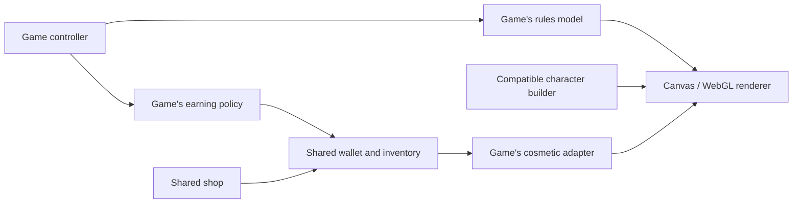

# games.cooper.tips

A playful single-page playground inspired by [neal.fun](https://neal.fun), bundling a few quick mini-games you can host on GitHub Pages.

## Games

- **Hot & Cold** — Hunt down a mystery number with warmer/colder hints on every guess.
- **Flash Reflex** — Train your reaction speed by tapping the moment the panel lights up.
- **Flappy Bird** — Customize birds (including a baby dragon and unlockable phoenix), pipes, backgrounds, accessories, and seven colors. Fly in side view or first-person 3D (Beta) across four difficulty levels, earn coins, and unlock new looks in the shop.
- **Snake** — Glide through the garden and gobble up apples. Customize a Generic, Gardener, Python, or Rattlesnake skin in eight colors, add hats, glasses, and neckwear, and toggle music and sound effects.
- **Aurora Archery** — Customize your archer, bow, and arrows in a mountain landscape, and explore six trails with moving targets, changing wind, and distances from 20 to 70 meters.
- **Runway Glide** — Line up the runway lights and land the plane on target.
- **Rocket Boost** — Hold boost, stage within the target band, and reach orbit.
- **Switchyard Signals** — Flip the switch before each train hits the junction.
- **Red Light Green Light** — Hold to sprint toward the finish while freezing the instant the signal turns red.
- **Memory Loop** — Flip cards to match every pair, tuning the tile count to dial up the difficulty.
- **Tower Stack** — Drop moving blocks with precise timing to grow the tallest, straightest tower.
- **Orbit Dash** — Hold Dash/space to burst outward through the glowing gate, release to reset your orbit, and chain flawless passes for a faster streak.
- **Pop Dash** — Click bubbles the instant they appear to keep the streak alive before they burst.
- **Nim Duel** — Choose a pile, remove 1–3 matches, and take the final match to win against four computer difficulties.
- **Bubble Rally** — Race glass bubbles across three ocean circuits with 2-4 human/computer racers. Choose each computer's difficulty, manage energy, raise shields, and pop rivals back to checkpoints.
- **Skyport Command** — Pick a contract, ensure you have the energy, dispatch a drone, and reinvest the cargo/credits before the 3-minute day ends.
- **Harmonic Echo** — Master a growing instrument sequence across dynamic difficulty modes.
- **Spot Clash** — Race an AI rival to find the shared symbol across dueling glyph cards.
- **Cats vs Dogs** — Lead the feline squad in a tile-by-tile tug-of-war to control Meadow Park.
- **Lights Down** — A compact Lights Out puzzle; toggle tiles (and their neighbors) to dim the board.
- **Submerged Explorer** — Glide through ocean zones, collect samples, and finish mission objectives in a retro submarine.
- **Spotlight** — Compare two vibrant scenes and spot every subtle difference against the clock.
- **Food Chain Relay** — Shuffle producers, consumers, and apex predators back into order to prove you understand energy flow.
- **Neon Drift** — Pick from five routes, four difficulty levels, and four cars with special abilities. Traffic and speed build with distance. Choose a 1 km, 3 km, 8 km, or endless drive, with crash explosions, varied vehicles, music, and sound effects.

Neon Drift controls: A/D or Left/Right arrows steer, Space or W boosts, and E or Up Arrow activates your car's ability. Comet GT has a nitro surge, Sentinel SUV shields one impact and flings the other car away, Phantom Coupe phases through traffic, and Rally RS slows approaching traffic and improves handling. Country Curves has blind bends and hills; Alpine Pass has fog and crests; Midnight Rain has slippery steering; Canyon Crosswinds has gusts and heavy trucks. Music and Sound FX can be toggled separately, and your choices are saved in this browser.

Bubble Rally's **Race setup** supports two, three, or four seats with any mix of humans and computers, including computer-only races to watch. Each computer independently uses Easy, Medium, Hard, or Expert. **Vs computer** and **Local multiplayer** are quick presets; the roster allows mixed groups. Multiplayer is on one device, with no server or room codes. Names, roster, circuit, and sound preference save locally. Setup changes apply to the next race, and the starting seat rotates on rematches.

Roll a fair 1-6 die, then choose **Cruise** (recover 1 energy), **Boost** (spend 2 for +2 spaces), **Brake** (move 2 fewer, minimum 1, recover 2 energy), or **Shield** (spend 2 to block one storm or incoming pop). Energy starts at 2 and caps at 6. Brake lets you recharge for later or change your landing tile. Landing effects trigger once: currents (`>>`) move forward 2 spaces, charge tiles (`E+2`) add 2 energy, and storms (`-2`, or `-3` in Tempest Run) push you back. Passing these tiles has no effect, and tile effects never chain. Reaching or passing tiles 10 and 20 saves a checkpoint; storms cannot push you behind it. Ending a move on a rival pops them back to their checkpoint unless shielded; START, checkpoints, and FINISH allow safe sharing. A shield breaks after blocking one storm or incoming pop. Reach or pass tile 31 to win. Human moves wait for **Next racer**; computer turns advance automatically. Pause freezes pending rolls, moves, and computer decisions. Hidden tabs pause timers without catch-up bursts, and leaving the game disposes the renderer and opponent clock.

Crystal Lagoon offers sunny tropical scenery and gentler hazards, Prism Circuit balances the tile types over a moonlit ocean, and Tempest Run has a stormy sea where shielding is more valuable. Each backdrop loads when its circuit is selected and has a procedural fallback. Move cards show the final destination, resulting energy, and tile effects even on touch screens. Hover or keyboard focus also highlights the path and explains each step; completed moves retain that breakdown and appear in the race log. The guide includes a worked Brake example. The board shares the cover's glass-and-waterfall platforms and four iridescent bubble sprites, with moving tokens, pop particles, shields, a finish arch, and optional synthesized sound effects. Winners rise onto a crowned podium with fireworks and confetti, followed by a Race again button. Narrow screens use a taller four-column board; reduced-motion preferences shorten moves and show a static victory podium. Artwork provenance and exact generation prompts are in [assets/bubble-rally-art.json](assets/bubble-rally-art.json).

Bubble Rally plays a seven-second, 60 fps finish video in the winner's color before showing the results podium. The bubble rolls and bounces across the existing glass-and-waterfall landings, passes through the board's checkered finish arch at about three seconds, and receives a crown. Flowing water, landing ripples, and confetti accompany an original soundtrack of water, rolling, jumps, and a synchronized finish fanfare. The clip's **Sound on/off** button shares the game's saved sound preference. **Finish clips & character names** lets you customize the title for each color; blank entries use the racer name. The **Winner name** field beneath a playing clip edits the same saved title. Text is an HTML overlay, so changing a name does not require regenerating video. Reduced-motion users see a static winner card and can choose **Play clip**. **Continue to results** or Escape returns to the game.

For temporary review, keys **1 / 2 / 3 / 4** preview **Cyan / Coral / Amber / Violet**, including colors outside the current roster. Preview buttons also work on touch screens. Shortcuts ignore text fields, modifiers and held-key repeats. Previewing pauses the opponent clock and board animation without changing positions, energy, turns or winners; closing resumes the previous state, including a manually paused race. Set `ENABLE_FINISH_PREVIEWS` to `false` in `bubble-rally.js` to remove the temporary controls and shortcuts. Clip names and normal win playback remain. The exported H.264/AAC MP4 files and JPEG posters live in `assets/bubble-rally-finish-*`. `scripts/bubble-rally-cinematic.js` draws the scene and encodes every frame through browser WebCodecs; `scripts/bubble-rally-cinematic-audio.mjs` generates the soundtrack WAV. The board and clip source share their arch drawing in `bubble-rally-art.js`. Only the selected color's movie is loaded, and playback needs no game backend.

Snake controls: arrow keys, WASD, or the on-screen arrows steer; Space pauses and resumes. Skin, color, and accessory changes apply immediately without restarting. Mix a straw hat, royal crown, party hat, or flower crown with round glasses or sunglasses and a bandana, bow tie, or scarf. Hat's "Match skin" option gives the Gardener a straw hat; "None" removes it. Appearance, Music, and Sound FX preferences are saved in this browser. Music starts with a game, pauses when you pause, and stops when you leave Snake.

Red Light Green Light has a scrolling **bird's-eye 2D track** and a third-person **3D race (Beta)** in a park. The overhead cartoon runner has alternating bent-arm strides, parallel lanes, and a finish-distance marker; the 3D view follows behind the runner. Hold the run button or Space on green, release during the half-second amber warning, and stay still on red. Both views share the original 18 m/s speed, random green/red durations, five finite courses (50-300 m), and Endless mode. Best finish times and longest endless distance save locally. Pause/Resume keeps your position; leaving the window or changing views pauses the round and releases the run input. If 3D cannot load, the race stays playable in 2D.

The **Sound FX** button toggles countdown beeps, green/amber/red signal cues, footsteps, the caught buzzer, and a finish fanfare in both views. Your preference saves in this browser. Effects start with a play gesture, stop on pause or when leaving the game, and are synthesized locally through Web Audio without audio downloads. The game remains playable when audio is unavailable.

Use **Customize runner** or choose the game's original cover in the character library at `/#characters/redlight`. The runner studio contains three outfits, three body builds, seven hairstyles, five facial hair choices, headwear, glasses, wrist accessories, and nine independent colors. All runner options are free and cosmetic. The 2D artwork is the default, with full-body and face previews in either view. The 3D rig shares the arcade's anatomical head asset and material/surface tools, and freezes its running pose when you stop. Changing an outfit preserves hair and colors.

Aurora Archery is in the main game list. Drag in the range or use the angle and power sliders to aim; Space shoots and P pauses. Up/Down adjusts angle, Left/Right adjusts power. You have six arrows to reach each trail's displayed goal. Gold scores 9-10 points, with lower scores toward the outside and zero for a miss. The dotted flight guide assumes the current wind stays steady: rightward wind pushes arrows farther, while leftward wind slows them down. Lead moving targets by aiming where they will be when the arrow arrives.

Use **View mode** above the range to switch between Classic side view and **First-person 3D (Beta)**. First-person mode looks down a perspective range with your customized bow, arrow, sleeves, and hands in the foreground. The arms have tapered forearms, smooth skin shading, wrists, fingers that grip the bow and draw the string, and a release and reload animation. Skin, sleeve, and trim colors follow your avatar; rangers wear leather bracers and knights wear metal guards. Drag up or down to change your bow angle without an initial jump. The crosshair shows the launch direction; the dotted circle shows the predicted landing point after gravity and wind. **Focus target (2x)** magnifies the range for distant targets. Tailwinds travel away from you; headwinds come toward you. All six trails use the same shots, scoring, and controls in either view. You can switch during a shot or while paused. Your view and focus preferences save automatically.

First Flight teaches the bow. Meadow Breeze gives each arrow a different wind, held steady while you aim and shoot. Lantern Lift moves the target, while Gusty Gorge changes wind continuously, including during flight. Longshot Lake changes distance after each arrow, between 35 and 70 meters, with calm wind. Aim and power stay unchanged when conditions change, so recalibrate before your next shot. Shot history records the distance and wind for comparison. Aurora Finale combines shifting wind with a target moving between 54 and 66 meters.

Use **Customize archer & bow** below the instructions to open the central character library. It retains every original avatar, bow, and arrow option, alongside matching 2D artwork and a rotatable 3D character (Beta). All appearance choices are cosmetic and save automatically with your best scores and earned stars in this browser.

Start with a Trail ranger, Woodland scout, or Aurora knight, then use the Face, Hair, and Outfit tabs. Choose skin and eye colors, face shape, freckles or a scar, seven hairstyles, six facial hair styles, independent hair and beard colors, five headwear options, glasses, an eye patch or an earring, outfit and trim colors, and boots. Headwear has its own color; changing outfits preserves your hair and headwear. Color palettes include a custom color picker. Switch between the full-body preview and a face close-up to see the details.

The bow section has a dedicated close-up of the Woodland longbow, Swift recurve, or Aurora crystal bow. Choose six preset colors, a custom color, and three grip wraps. The previews and the archer on the range share the same artwork. Woodcraft, Moonsteel, and Aurora crystal arrows also offer six feather colors.

Flappy Bird controls: tap or click the scene, use the Flap button, or press Space, W, or Up to climb. P pauses or resumes; R restarts. The main counter shows actual pipe pairs cleared, one per opening. Difficulty points are separate: Easy gives 1 point, Medium 3, Hard 6, and Expert 10 per pipe. Hard is the starting mode. Easy keeps gentle gravity and wide gaps; higher difficulties fall faster, use tighter openings, and change vertical level at every pair. Course acceleration depends on actual pipes cleared, so point multipliers do not multiply its pace. Hitting a pipe or the ground ends the flight with a tumble and feather animation. Sound FX toggles the retro flap, scoring, and impact sounds.

Coin rewards are exactly 1 per pipe on Easy, 3 on Medium, 5 on Hard, and 10 on Expert. Coin payouts use actual pipe counts, with no extra coin bonuses. Bronze, Silver, Gold, and Diamond medals recognize 5, 15, 30, and 60 cleared pipes. Zero-pipe flights earn nothing. Coins bank once when the flight ends, including restarting, changing difficulty, or leaving the game. The Sky Shop's ten permanent cosmetic unlocks cost 150-900 coins. Buying equips the item immediately, and owned items can be re-equipped freely. Existing purchases and balances are preserved.

Use Play, Customize, and Shop to open `/#flappy`, the central studio at `/#characters/flappy`, and `/#flappy/shop`. The old `/#flappy/customize` link redirects to the central studio. The Flappy shop pauses and preserves a flight; leaving for the shared library or another game settles its earned coins and starts a fresh flight when you return. Browser Back and Forward work between pages. First-person 3D (Beta) uses the same flight rules and scoring. Line up its center ring with the dotted circle in the next opening.

Each bird has its own artwork and motion: a fluffy sparrow, crested and striped jay, forward-facing owl, hovering hummingbird, scaled dragon with membrane wings, and glowing phoenix. The first-person wings and beaks match the character. Natural colors applies the selected species' recommended palette; individual colors and accessories remain independently editable. Characters, colors, accessories, views, records, coins, and purchases save in this browser.

## Shared arcade platform

The header opens the shared shop at `/#store` and the character library at `/#characters`. Flappy Bird, Aurora Archery, Snake, and Neon Drift earn the same in-game coins. Flappy's rates remain Easy 1, Medium 3, Hard 5, and Expert 10 per pipe. Archery earns one coin per scored point; Snake earns 1/1/2/3/4 per apple on Sloth/Easy/Classic/Fast/Blitz; Neon Drift earns 1/2/3/5 per 100 meters on Easy/Medium/Hard/Expert. Snake remembers the difficulty of each apple instead of increasing old rewards when the speed changes. Existing Flappy balances and permanent purchases migrate once. Records and appearance settings keep their original save keys.

The shop includes the existing Flappy items and two cosmetic collections that can be applied independently to the four games. Coins cannot buy speed, extra lives, altered hitboxes, or stronger abilities. There are no real-money payments. Progress is local to this browser and origin, without an account or a game backend.

The character library opens with a game-selection page. Pick Flappy Bird, Aurora Archery, Snake, Neon Drift, or Red Light Green Light to open its complete customization controls, or use **All games** to return to the selection. Direct studio links and each game's Customize button still open the relevant editor. Browser Back and Forward work between the selection and studios.

Each studio starts with **2D artwork**, the original cartoon drawing from the game. Select **3D character (Beta)** to load, rotate, and zoom the corresponding WebGL model. Both views read the same saved colors, skins, features, accessories, and equipment. All 3D options, including the first-person modes in Flappy Bird and Aurora Archery, are labeled **Beta**. Flappy Bird also has a separate **Background & pipes** preview next to its world settings; scenery, pipe style, and pipe color update together using the game's artwork. Archery retains face and bow/arrow close-ups. The library does not run a game or award coins. Each game links here instead of maintaining a separate visible character editor; its saved appearance is used when you return to play. If WebGL is unavailable, the studio shows the original 2D artwork and keeps all controls working.

The `arcade/` modules form an opt-in platform; games without characters or coins do not need to depend on them:

| Module | Responsibility |
| --- | --- |
| `characters.js` | Compatible casts and immutable `GameCharacter` instances built with `CharacterBuilder`; appearance only, with no physics fields. |
| `runtime.js` | Canvas 2D surfaces, pixel scaling, and disposable frame loops. |
| `opponents.js` | Shared Easy/Medium/Hard/Expert decisions, accuracy, reaction windows, bounded tapping pace, and cancellable/visibility-aware action scheduling. |
| `opponent-strategies.js` | Game-specific public-state adapters: legal bounded-Nim moves, winning-position evaluation, fair openings, and shared tug rules. |
| `babylon.js` | Lazy-loaded, locally hosted Babylon.js scenes, perspective/orthographic cameras, PBR materials, lighting, and optional soft shadows. |
| `character-renderers.js` | Compatible WebGL bird, humanoid, snake, vehicle, and runner characters; shares models between studios and gameplay. |
| `humanoid-mesh.js`, `accessory-mesh.js` | Full archer appearance and creature accessories, including independent hair, outfit, and equipment. |
| `studio-preview.js`, `studio-2d.js` | Character-only 2D/3D preview, orbit camera, face/equipment focus, and original game artwork adapters. |
| `editor-hub.js` | Game-selection page and central studio routes that mount the original full customization controls and save through each game's appearance settings. |
| `flappy-webgl.js` | Flappy's enhanced first-person renderer; reads its existing rules model without advancing or modifying it. |
| `runner-mesh.js`, `redlight-webgl.js` | Articulated runner and 3D park track; the renderer reads the shared Red Light Green Light rules model. |
| `catalog.js` | Product definitions, prices, supported games, and cosmetic collections. |
| `wallet.js` | One wallet, shared inventory, migration, incremental reward receipts, subscriptions, and purchase transactions. |
| `game-services.js` | Per-game earning policies and cosmetic adapters connecting games to the shared services. |
| `hub.js` | Shared navigation, shop, and collection inventory. |

Composition follows `game controller -> game rules model -> renderer`. Controllers report achievements to reward sessions, which credit only the increase for a run. Purchases and credits read the latest wallet and use the browser's Web Locks API when available to serialize changes between tabs. Renderers receive a model to display; they do not own game rules. Character builders reject incompatible families and unsupported appearance fields, so an archer cannot become a Flappy bird or acquire driving abilities.

Bubble Rally, Nim Duel, Food Chain Relay, Spot Clash, and Cats vs Dogs all use the central computer-opponent policy. A game supplies legal actions and a score based on public state; `createComputerOpponent().choose(actions, evaluate)` chooses within that set. Outcome randomness (such as Bubble Rally dice) stays in the game's rules model, separate from computer decision randomness. Reaction games use `planReaction()`, the food-chain race uses `attempt()`, and tug uses `nextTapDelay()` with the same pull per tap as the human. Expert remains fallible, reactions have a 900 ms floor, and tug pace never scales with the human's tapping speed. Nim uses the correct bounded-removal value, XOR of pile counts modulo 4, and starts the human in a position with a winning line. Games retain their own scoring, controls, and victory conditions.

Run `node --test tests/opponents.test.mjs tests/bubble-rally.test.mjs` for legal-action, die-fairness, energy/shield/checkpoint, move explanations, multiplayer, scheduler, and difficulty checks. With Brake restoring 2 energy, a fixed tactical strategy won 428/600 Easy, 375/600 Medium, 320/600 Hard, and 310/600 Expert seeded Bubble Rally matches, alternating starters across all three circuits. These are reproducible calibration results, not predicted human win rates. Additional three- and four-seat simulations finish on every circuit, and a six-taps-per-second tug strategy can overcome expert with normal rope tension.



```js
import { CharacterBuilder } from "./arcade/characters.js";
import { createRewardSession } from "./arcade/game-services.js";

const character = new CharacterBuilder("archery", "ranger")
  .withColors({ body: "#40756a", skin: "#dfae88" })
  .withFeature("hair", "braids")
  .build();

// Create one session per run, outside the frame loop.
const rewards = createRewardSession("archery");
// Report actual scored progress after a shot. Repeating the same total pays nothing.
await rewards.award({ score: 10 });
```

For a new game, register a compatible character family only if it needs characters, define its earning policy only if it should award coins, and add cosmetic adapters that change appearance rather than the rules model. Keep its simulation, collisions, controls, scoring, difficulty, and abilities in its own modules. New rendering adapters can share the runtime and asset/character definitions without inheriting another game's mechanics.

Babylon.js **9.31.0** is pinned under `vendor/babylonjs/`, with its Apache 2.0 license, notice, source URL, and verified package integrity. Its 8.6 MB engine loads only when a WebGL view is requested. No npm install, build step, runtime engine CDN, or backend is required to deploy these static files to GitHub Pages. The runtime supports Canvas 2D, SVG, perspective WebGL, and orthographic WebGL. Flappy's **Enhanced first-person 3D (Beta)** uses the same engine; the original views remain available, and devices without WebGL fall back to classic rendering.

This is the rendering foundation for higher-fidelity 3D. Current characters and worlds use procedural, stylized artwork. Photorealistic results will also need suitable models, textures, environment lighting, and device-specific performance budgets; selecting an engine does not turn existing drawings into photorealistic assets.

Run `node --test tests/*.test.mjs` for game rules and shared platform checks. `tests/arcade.test.mjs` covers cast compatibility, full studio appearance mapping, cosmetic isolation, migration, cross-game purchases, duplicate rewards, concurrent purchases, unavailable storage, reward policies, and frame-loop cleanup.

## Getting Started

1. Clone the repository: `git clone https://github.com/<your-user>/games.cooper.tips.git`
2. Install dependencies (none required) and choose a local preview option:
   - Open `index.html` directly in a browser for a quick check (no build step).
   - Run a static server for live reloads and correct SPA routing. Examples:
     - `npx serve .`
     - `python3 -m http.server 4173`
   - Keep the terminal open while you edit; the browser reloads automatically on refresh.

## Local Testing

The project is entirely client-side, so functional testing is manual:

- Walk through each game module after making changes to confirm interactions still work.
- Use browser devtools for responsive checks; the layout adapts down to small screens.
- Optional: enable network throttling or reduced motion in devtools to test accessibility quirks.

Neon Drift's driving rules also have focused automated checks: `node --test tests/neon-drift.test.mjs`. Its simulation, canvas rendering, and Web Audio soundtrack are in `neon-drift-engine.js`, `neon-drift.js`, and `neon-drift-audio.js`; no build step or dependencies are required.

Aurora Archery's flight, scoring, wind, target motion, round rules, perspective projection, and first-person aiming have focused checks: `node --test tests/archery*.test.mjs`. Its rules, side view, first-person renderer, camera, appearance, and controls are in `archery-engine.js`, `archery-renderer.js`, `archery-first-person.js`, `archery-camera.js`, `archery-appearance.js`, and `aurora-archery.js`.

Flappy Bird's flight rules, collision detection, scoring, course reachability, saved-score migration, customization validation, perspective math, coin awards, and shop purchases have focused checks: `node --test tests/flappy.test.mjs`. Its modules are `flappy-engine.js`, `flappy-appearance.js`, `flappy-bird-art.js`, `flappy-renderer.js`, `flappy-audio.js`, `flappy-shop.js`, and `flappy-bird.js`.

Red Light Green Light's signal boundaries, hold/release input, pause, finish timing, endless progress, and runner appearance/save validation have focused checks: `node --test tests/redlight.test.mjs`. `redlight-engine.js` owns the rules; `red-light-green-light.js` handles controls and lifecycle; `redlight-renderer.js` and `arcade/redlight-webgl.js` render the same model. `redlight-appearance.js` and `redlight-customizer.js` supply the shared character studio.

## Deployment

Because the project is fully static (HTML/CSS/JS), you can deploy it as-is via GitHub Pages.

### GitHub Actions workflow

1. Ensure the repository has GitHub Pages enabled via **Settings → Pages** and choose **GitHub Actions** as the source.
2. Commit the workflow in `.github/workflows/deploy.yml` (included here) to the default branch.
3. On every push to `main`, the workflow uploads the static files and publishes them to Pages. The generated URL appears in the workflow summary.

### Manual publishing (fallback)

1. Push the `index.html`, `style.css`, and `script.js` files to the repository's default branch.
2. In **Settings → Pages**, choose the branch and root directory (`/`).
3. Save and wait for GitHub Pages to publish. Visit `https://games.cooper.tips` to play.

## Customization

The structure is intentionally lightweight. Add new games by extending the `games` array in `script.js` with a new entry that implements an `init(root)` function returning a cleanup callback. Style additions can live alongside the provided design language in `style.css`.
