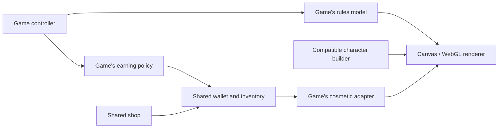

# games.cooper.tips

A playful single-page playground inspired by [neal.fun](https://neal.fun), bundling a few quick mini-games you can host on GitHub Pages.

## Appearance

Use **Light** or **Dark** beside the home-page tagline to choose one interface theme for the whole arcade, including games, the shop, and character studios. Dark keeps the original blue/green page glow and cyan/gold tile gradients; Light uses blue, mint, and cream gradients with dark text. The switch stays available while playing and updates the colors without restarting a game. Dark is the default; the choice saves in this browser and syncs across open tabs. Game artwork, scenery, character colors, and gameplay signals retain their intended colors.

`theme.js` restores the preference before styles load and passes it to the embedded Submerged game. `theme.css`, loaded after the game styles, supplies the shared `--ui-*` palette and the existing games' interface adaptations. New interface panels should use these tokens; keep scene materials and customization swatches independent of the UI theme.

## Games

- **Hot & Cold** — Hunt down a mystery number with warmer/colder hints on every guess.
- **Flash Reflex** — Train your reaction speed by tapping the moment the panel lights up.
- **Flappy Bird** — Customize birds (including a baby dragon and unlockable phoenix), pipes, backgrounds, accessories, and seven colors. Fly in side view or first-person 3D (Beta) across four difficulty levels, earn coins, and unlock new looks in the shop.
- **Snake** — Glide through the garden and gobble up apples. Customize a Generic, Gardener, Python, or Rattlesnake skin in eight colors, add hats, glasses, and neckwear, and toggle music and sound effects.
- **Aurora Archery** — Customize your archer, bow, and arrows in a mountain landscape, and explore six trails with moving targets, changing wind, and distances from 20 to 70 meters.
- **Runway Glide** — Fly four distinct aircraft through eight 3D landing approaches, with wind, traffic, spoken tower guidance, and an extreme aircraft-carrier landing.
- **Free Flight** — Explore a continuing 3D world in four aircraft, with coastal, mountain, and island airfields for optional landings and takeoffs. No missions or time limit.
- **Rocket Boost** — Build and fly a multi-stage rocket from Earth to space in 3D (Beta), with six missions, crew or payload flights, orbital delivery, re-entry, and a free-play assembly bay. Currently in Coming Soon.
- **Switchyard Signals** — Dispatch passenger trains across six cartoon railway districts, set junctions and signals, avoid explosive collisions, and ride inside any train in first-person 3D (Beta). Temporarily available in the main games list.
- **Red Light Green Light** — Hold to sprint toward the finish while freezing the instant the signal turns red.
- **Memory Loop** — Match illustrated cards across five layouts. Play solo, with 2-4 friends on one device, or against four computer levels; earn shared coins and collect new picture sets and card backs. Available in the main games list.
- **Tower Stack** — Drop moving blocks with precise timing to grow the tallest, straightest tower.
- **Orbit Dash** — Hold Dash/space to burst outward through the glowing gate, release to reset your orbit, and chain flawless passes for a faster streak.
- **Pop Dash** — Click bubbles the instant they appear to keep the streak alive before they burst.
- **Nim Duel** — Take 1–3 matches from one pile, watch them burn away, and claim the final match. Play four computer difficulties or two players on one device around a stone tabletop with brass-edged wooden trays.
- **Bubble Rally** — Race glass bubbles across three ocean circuits with 2-4 human/computer racers. Choose each computer's difficulty, manage energy, raise shields, and pop rivals back to checkpoints.
- **Skyport Command** — Pick a contract, ensure you have the energy, dispatch a drone, and reinvest the cargo/credits before the 3-minute day ends.
- **Harmonic Echo** — Master a growing instrument sequence across dynamic difficulty modes.
- **Spot Clash** — Race the computer to find the one shared picture across two illustrated cards. Clear point reveals highlight both matches and explain who scored before you choose the next pair.
- **Cats vs Dogs** — Lead Team Whiskers or Team Woof in a rhythm tug-of-war. Time pulls, rest to recover stamina, and charge super pulls in a best-of-three championship.
- **Haunted Harvest** — Gather candy across three haunted paths, solve riddles and ordered spells, manage fright, and carve glowing jack-o'-lanterns in a drawing workshop.
- **Lights Down** — A compact Lights Out puzzle; toggle tiles (and their neighbors) to dim the board.
- **Submerged Explorer** — Glide through ocean zones, collect samples, and finish mission objectives in a retro submarine.
- **Spotlight** — Compare detailed illustrated scenes at Easy, Medium, Hard, and Expert. Earn shared coins, unlock picture collections and frames, or explore in untimed practice. Available in the main games list while being improved.
- **Food Chain Relay** — Shuffle producers, consumers, and apex predators back into order to prove you understand energy flow.
- **Neon Drift** — Pick from five routes, four difficulty levels, and four cars with special abilities. Traffic and speed build with distance. Choose a 1 km, 3 km, 8 km, or endless drive, with crash explosions, varied vehicles, music, and sound effects.

Neon Drift controls: A/D or Left/Right arrows steer, Space or W boosts, and E or Up Arrow activates your car's ability. Comet GT has a nitro surge, Sentinel SUV shields one impact and flings the other car away, Phantom Coupe phases through traffic, and Rally RS slows approaching traffic and improves handling. Country Curves has blind bends and hills; Alpine Pass has fog and crests; Midnight Rain has slippery steering; Canyon Crosswinds has gusts and heavy trucks. Music and Sound FX can be toggled separately, and your choices are saved in this browser.

Bubble Rally's **Race setup** supports two, three, or four seats with any mix of humans and computers, including computer-only races to watch. Each computer independently uses Easy, Medium, Hard, or Expert. **Vs computer** and **Local multiplayer** are quick presets; the roster allows mixed groups. Multiplayer is on one device, with no server or room codes. Names, roster, circuit, and sound preference save locally. Setup changes apply to the next race, and the starting seat rotates on rematches.

Roll a fair 1-6 die, then choose **Cruise** (recover 1 energy), **Boost** (spend 2 for +2 spaces), **Brake** (move 2 fewer, minimum 1, recover 2 energy), or **Shield** (spend 2 to block one storm or incoming pop). Energy starts at 2 and caps at 6. Brake lets you recharge for later or change your landing tile. Landing effects trigger once: currents (`>>`) move forward 2 spaces, charge tiles (`E+2`) add 2 energy, and storms (`-2`, or `-3` in Tempest Run) push you back. Passing these tiles has no effect, and tile effects never chain. Reaching or passing tiles 10 and 20 saves a checkpoint; storms cannot push you behind it. Ending a move on a rival pops them back to their checkpoint unless shielded; START, checkpoints, and FINISH allow safe sharing. A shield breaks after blocking one storm or incoming pop. Reach or pass tile 31 to win. Human moves wait for **Next racer**; computer turns advance automatically. Pause freezes pending rolls, moves, and computer decisions. Hidden tabs pause timers without catch-up bursts, and leaving the game disposes the renderer and opponent clock.

Crystal Lagoon offers sunny tropical scenery and gentler hazards, Prism Circuit balances the tile types over a moonlit ocean, and Tempest Run has a stormy sea where shielding is more valuable. Each backdrop loads when its circuit is selected and has a procedural fallback. Move cards show the final destination, resulting energy, and tile effects even on touch screens. Hover or keyboard focus also highlights the path and explains each step; completed moves retain that breakdown and appear in the race log. The guide includes a worked Brake example. The board shares the cover's glass-and-waterfall platforms and four iridescent bubble sprites, with moving tokens, pop particles, shields, a finish arch, and optional synthesized sound effects. The winner's finish clip leads to a podium for every racer and a Race again button. Narrow screens use a taller four-column board; reduced-motion preferences shorten moves and show a static victory podium. Artwork provenance and exact generation prompts are in [assets/bubble-rally-art.json](assets/bubble-rally-art.json).

Bubble Rally automatically plays a seven-second, 60 fps finish video in the winner's color, using the name entered in **Race setup** at the start of that race. The bubble rolls and bounces across the existing glass-and-waterfall landings, passes through the board's checkered finish arch at about three seconds, and receives a crown. Flowing water, landing ripples, and confetti accompany an original soundtrack of water, rolling, jumps, and a synchronized finish fanfare. Playback follows the game's saved **Sound on/off** preference. The movie has no preview, editing, or playback controls, and fades directly into the podium when it ends. Escape skips to the podium. Reduced-motion users see a brief static winner card before the results; failed or stalled video also falls back automatically.

The podium includes every racer, with their name, colored bubble, placement, and final tile. With three or four racers, the winner is centered on a separate upper row and the remaining places run left to right below. Two racers appear side by side, with the winner on the left. The first finisher takes 1st; other racers rank by their final tile when the race ends. Equal positions share a place, using competition ranks such as 1st, tied 2nd, tied 2nd, and 4th. **Race again** starts a rematch and rotates the starting seat.

The **Temporary podium test** panel uses the current setup's names and two-to-four racer count. Choose final tile positions and click a color's **wins** button to watch its clip fade into the podium. **Play victory clip first** starts checked; uncheck it to inspect standings immediately. Previews pause the real race, and **Back to race** restores its state and any manual pause. The previous number-key cheats and separate winner-name overrides are removed. Set `ENABLE_PODIUM_TESTS` to `false` in `bubble-rally.js` after review to remove this temporary panel.

The exported H.264/AAC MP4 files and JPEG posters live in `assets/bubble-rally-finish-*`. `scripts/bubble-rally-cinematic.js` draws the scene and encodes every frame through browser WebCodecs; `scripts/bubble-rally-cinematic-audio.mjs` generates the soundtrack WAV. The board and clip source share their arch drawing in `bubble-rally-art.js`. Winner names are HTML overlays, so changing a racer name requires no video regeneration. Only the selected color's movie is loaded, and playback needs no game backend.

Snake controls: arrow keys, WASD, or the on-screen arrows steer; Space pauses and resumes. Skin, color, and accessory changes apply immediately without restarting. Mix a straw hat, royal crown, party hat, or flower crown with round glasses or sunglasses and a bandana, bow tie, or scarf. Hat's "Match skin" option gives the Gardener a straw hat; "None" removes it. Appearance, Music, and Sound FX preferences are saved in this browser. Music starts with a game, pauses when you pause, and stops when you leave Snake.

Red Light Green Light has a scrolling **bird's-eye 2D track** and a third-person **3D race (Beta)** in a park. The overhead cartoon runner has alternating bent-arm strides, parallel lanes, and a finish-distance marker; the 3D view follows behind the runner. Hold the run button or Space on green, release during the half-second amber warning, and stay still on red. Both views share the original 18 m/s speed, random green/red durations, five finite courses (50-300 m), and Endless mode. Best finish times and longest endless distance save locally. Pause/Resume keeps your position; leaving the window or changing views pauses the round and releases the run input. If 3D cannot load, the race stays playable in 2D.

The **Sound FX** button toggles countdown beeps, green/amber/red signal cues, footsteps, the caught buzzer, and a finish fanfare in both views. Your preference saves in this browser. Effects start with a play gesture, stop on pause or when leaving the game, and are synthesized locally through Web Audio without audio downloads. The game remains playable when audio is unavailable.

Use **Customize runner** or choose the game's original cover in the character library at `/#characters/redlight`. The runner studio contains three outfits, three body builds, seven hairstyles, five facial hair choices, headwear, glasses, wrist accessories, and nine independent colors. All runner options are free and cosmetic. The 2D artwork is the default, with full-body and face previews in either view. The 3D rig shares the arcade's anatomical head asset and material/surface tools, and freezes its running pose when you stop. Changing an outfit preserves hair and colors.

Aurora Archery is in the main game list. Drag in the range or use the angle and power sliders to aim; Space shoots and P pauses. Up/Down adjusts angle, Left/Right adjusts power. You have six arrows to reach each trail's displayed goal. Gold scores 9-10 points, with lower scores toward the outside and zero for a miss. The dotted flight guide assumes the current wind stays steady: rightward wind pushes arrows farther, while leftward wind slows them down. Lead moving targets by aiming where they will be when the arrow arrives.

Use **View mode** above the range to switch between Classic side view and **First-person 3D (Beta)**. First-person mode looks down a perspective range with your customized bow, arrow, sleeves, and hands in the foreground. The arms have tapered forearms, smooth skin shading, wrists, fingers that grip the bow and draw the string, and a release and reload animation. Skin, sleeve, and trim colors follow your avatar; rangers wear leather bracers and knights wear metal guards. Drag up or down to change your bow angle without an initial jump. The crosshair shows the launch direction; the dotted circle shows the predicted landing point after gravity and wind. **Focus target (2x)** magnifies the range for distant targets. Tailwinds travel away from you; headwinds come toward you. All six trails use the same shots, scoring, and controls in either view. You can switch during a shot or while paused. Your view and focus preferences save automatically.

First Flight teaches the bow. Meadow Breeze gives each arrow a different wind, held steady while you aim and shoot. Lantern Lift moves the target, while Gusty Gorge changes wind continuously, including during flight. Longshot Lake changes distance after each arrow, between 35 and 70 meters, with calm wind. Aim and power stay unchanged when conditions change, so recalibrate before your next shot. Shot history records the distance and wind for comparison. Aurora Finale combines shifting wind with a target moving between 54 and 66 meters.

Use **Customize archer & bow** below the instructions to open the central character library. It retains every original avatar, bow, and arrow option, alongside matching 2D artwork and a rotatable 3D character (Beta). All appearance choices are cosmetic and save automatically with your best scores and earned stars in this browser.

Start with a Trail ranger, Woodland scout, or Aurora knight, then use the Face, Hair, and Outfit tabs. Choose skin and eye colors, face shape, freckles or a scar, seven hairstyles, six facial hair styles, independent hair and beard colors, five headwear options, glasses, an eye patch or an earring, outfit and trim colors, and boots. Headwear has its own color; changing outfits preserves your hair and headwear. Color palettes include a custom color picker. Switch between the full-body preview and a face close-up to see the details.

The bow section has a dedicated close-up of the Woodland longbow, Swift recurve, or Aurora crystal bow. Choose six preset colors, a custom color, and three grip wraps. The previews and the archer on the range share the same artwork. Woodcraft, Moonsteel, and Aurora crystal arrows also offer six feather colors.

Flappy Bird controls: tap or click the scene, use the Flap button, or press Space, W, or Up to climb. P pauses or resumes; R restarts. The main counter shows actual pipe pairs cleared, one per opening. Difficulty points are separate: Easy gives 1 point, Medium 3, Hard 6, and Expert 10 per pipe. Hard is the starting mode. Easy keeps gentle gravity and wide gaps; higher difficulties fall faster, use tighter openings, and change vertical level at every pair. Course acceleration depends on actual pipes cleared, so point multipliers do not multiply its pace. Hitting a pipe or the ground ends the flight with a tumble and feather animation. Sound FX toggles the retro flap, scoring, and impact sounds.

Coin rewards are exactly 1 per pipe on Easy, 3 on Medium, 5 on Hard, and 10 on Expert. Coin payouts use actual pipe counts, with no extra coin bonuses. Bronze, Silver, Gold, and Diamond medals recognize 5, 15, 30, and 60 cleared pipes. Zero-pipe flights earn nothing. Coins bank once when the flight ends, including restarting, changing difficulty, or leaving the game. The Sky Shop's ten permanent cosmetic unlocks cost 150-900 coins. Buying equips the item immediately, and owned items can be re-equipped freely. Existing purchases and balances are preserved.

Use Play, Customize, and Shop to open `/#flappy`, the central studio at `/#characters/flappy`, and `/#flappy/shop`. The old `/#flappy/customize` link redirects to the central studio. The Flappy shop pauses and preserves a flight; leaving for the shared library or another game settles its earned coins and starts a fresh flight when you return. Browser Back and Forward work between pages. First-person 3D (Beta) uses the same flight rules and scoring. Line up its center ring with the dotted circle in the next opening.

Each bird has its own artwork and motion: a fluffy sparrow, crested and striped jay, forward-facing owl, hovering hummingbird, scaled dragon with membrane wings, and glowing phoenix. The first-person wings and beaks match the character. Natural colors applies the selected species' recommended palette; individual colors and accessories remain independently editable. Characters, colors, accessories, views, records, coins, and purchases save in this browser.

## Spot Clash

Each pair contains exactly one shared picture from a set of 25 detailed object illustrations. Tap that picture on **either card** before the computer finds it. A correct claim earns 1 point; a wrong claim gives the other player 1 point. Both players follow that same rule, and every computer difficulty can make mistakes.

Easy uses 5 pictures per card and a first-to-7 target; Medium uses 6 / first to 8, Hard uses 7 / first to 9, and Expert uses 8 / first to 10. The existing shared computer reaction speeds and accuracy are preserved. Pictures are shuffled independently on each card, with no repeated answer on consecutive pairs. The opponent starts searching only after the artwork loads and the cards are displayed.

Every point has a large **You +1** or **Computer +1** result, scorer labels on both cards, progress marks on the scoreboard, matching-picture highlights, and a separate wrong-pick marker when needed. The explanation distinguishes a fast match from an opponent's mistake. Results stay in place until you press **Next pair**, and the last five points remain visible in a small history. The final pair stays visible alongside a win/loss celebration, the final score, and your fastest successful match.

**Pause** stops both the computer and the deal, conceals the pictures, and preserves the remaining search time. Changing difficulty or starting a new match cancels pending actions. Leaving the browser tab suspends the opponent; leaving the game removes its timers and sounds. **Sound on/off** saves in this browser, and reduced-motion preferences keep the reveals static. Sounds are synthesized locally with Web Audio.

The rules live in `spot-clash-engine.js`, with rendering and controls in `spot-clash.js`, `spot-clash-art.js`, `spot-clash.css`, and `spot-clash-audio.js`. `assets/spot-clash-art.json` records the built-in image-generation prompts and saved artwork paths. Run `node --test tests/spot-clash.test.mjs tests/opponents.test.mjs` for pair generation, scoring, race resolution, and computer-policy checks.

## Nim Duel

Select one wooden tray, choose **1, 2, or 3**, and confirm with **Take**. The highlighted matches show exactly what will be removed; they ignite and burn down before the next turn. You cannot combine piles or remove more matches than a pile contains. Whoever takes the final match across the entire table wins. Emptying one tray alone does not end the round. There is no timer, and the rules include an example and an optional strategy tip.

**vs Computer** keeps Easy, Medium, Hard, and Expert on the shared opponent engine. The human opens, each generated table has a winning line, and the original bounded-Nim rules and computer decision policy are unchanged. **2 players** takes turns on the same device, supports player names, and alternates the starting player each round. Each mode keeps its own win counts for the current visit. Changing mode or difficulty starts a fresh round and cancels pending moves.

The final match leads into a golden win scene or a quieter computer-victory scene, with the winner named in local multiplayer. **Skip animation**, **Pause**, **New round**, and a persistent **Sound on/off** control are available. Effects pause with the game or hidden tab, and reduced-motion mode skips flames and moving celebrations. Ignition, crackling, and result sounds use local Web Audio; no backend or audio downloads are needed.

`nim-duel-engine.js` owns legal moves and round state, `nim-duel.js` handles the interface, and `nim-duel.css` / `nim-duel-audio.js` supply the artwork and effects. The stone-table cover is `assets/nim-duel-cover.png`; `assets/nim-duel-art.json` records its built-in image-generation and stone-surface edit prompts. Run `node --test tests/nim-duel.test.mjs tests/opponents.test.mjs` to check rules, opening positions, turn enforcement, and beatable computer play.

## Cats vs Dogs

The Paw Pull Championship pits your personalized cat and dog against each other in a rhythm tug of war. Choose Easy, Medium, Hard, or Expert computer opponents, or play with a friend on one keyboard or touchscreen. Reach your flag or lead after 24 beats to win a round; two round wins take the cup. Matches end after at most three rounds. A centered rope at the time limit triggers a final pull: wait for **GO**, then the first pull moves the rope to that team and wins the round. Early taps are ignored. With no pull, the tie waits; there is no timeout winner or automatic point. Tiny subpixel differences at the visible center count as centered. Computer opponents use a fallible reaction delay and the same pull rule.

The gold zone is 7% of the timing track, less than half its original width. Its position changes between beats and the beat accelerates by 30% during a round. Even within gold, closer timing means more strength (4.5-6 before other effects). Both teams' normal pulls resolve together, so input order gives neither team priority. Each team gets one attempt per beat. Pulling uses 20 stamina and recovers 8; resting restores 30, or 38 on Sunset Sands. Below 20 stamina, strength falls to 30%. Three healthy perfect pulls charge a super; the next perfect pull doubles its strength. Resting preserves the combo; weaker or exhausted pulls break it.

Each team receives **two free devices every round**, with one device in flight at a time. **Mud pie** weakens the opponent's pulls by 35% for two beats. **Squeaky toy** removes 22 stamina. Both attacks give a full beat of visible warning before landing. **Paw shield** clears mud and blocks attacks for three beats; use it during the warning to counter an attack. Shields resolve before attacks at the same boundary. Devices cannot be purchased or upgraded.

Meadow Cup opens at 1.5 seconds per beat, Sunset Sands at 1.8, and Firefly Grove at 1.22. Cats use **A** to pull and **Q / W / E** for Mud / Squeak / Shield. Dogs use **L** and **U / I / O**. Single-player also supports **Space** for your pet when a button is not focused. **P** pauses. Changing tabs or leaving the browser pauses the action. Changing match settings resets the match. Sound effects and optional music have separate toggles, and animations respect reduced motion.

The shared Character Library at `/#characters/catsdogs` uses the game's cover icon and contains only pet customization and previews. Ten free breeds include orange tabby, Siamese, calico, British shorthair, Maine Coon, golden retriever, Labrador retriever, pit bull, Welsh corgi and Siberian husky. Named coats include seal and **flame point Siamese**, **yellow, chocolate, white and black Labradors**, and white or blue British shorthairs. Choose any custom fur color or restore the natural coat. Save separate names, coats, hats, glasses, neck accessories and accessory colors for your cat and dog. The original 2D artwork is the default; a rotatable **3D character (Beta)** is also available. The same saved wardrobe appears in gameplay. The shared shop at `/#store/catsdogs` sells five cosmetic accessories for 180-400 coins, each unlocked for both pets. No appearance choice affects strength, stamina, timing or devices.

Open **Paint your own markings** to tap and drag up to 48 individual splotches, spots or stripes onto either pet. Move, erase, resize, rotate and recolor patches, enter precise positions, and undo or redo edits. Pattern presets provide movable starting points. Enter adds a patch, arrow keys move the selection, Shift makes smaller adjustments, and Delete removes it. Paint follows the fur silhouette and preserves facial details and accessories. Natural breed markings remain part of the artwork; white British shorthairs and white Labradors provide a plain coat to paint. Each pet's patch positions save independently and carry into the game and both previews. The Beta 3D view projects those positions onto corresponding body regions. New breed artwork and prompts are recorded in `assets/cats-dogs-coat-art.json`; the corrected four-legged cover and its edit prompt are recorded in `assets/cats-dogs-cover-fix-art.json`.

The studio has independent colors for **main fur**, **light fur / chest**, **natural markings / shading**, and the **classic bandana**, alongside the separate accessory color. Restore the natural coat without removing painted patches or changing the bandana. On solid coats, secondary colors blend into the chest, muzzle and ear shading. Both previews and the game use the saved colors. Painted spots retain source fur detail, softly textured edges, stable warm/cool undertones and shading that separates the foreground arms from the chest. Each marking also has **Fur detail scale** and **Coat undertone** controls alongside its size, angle and color. These controls save with the patch and apply in both ending poses.

Each source coat has measured face and accessory anchors. Fur recoloring retains the original transparency, texture, eyes and nose. Glasses fit the near and far eyes independently; hats, bows and medals follow the head and neck angles. The 2D accessories use detailed fabric, flower, metal and glass artwork, with adjustable colors; originals and built-in generation prompts are recorded in `assets/cats-dogs-accessory-art.json`.

During matches, pets blink on independent rhythms, breathe faster when tired, lean into their pulls and narrow their eyes. Dogs' whole ears lift, swivel to listen, flick and fold from fixed roots; floppy ears and pointed ears react differently to a strong pull, with independent timing and flexible tips. Cats twitch their ears and briefly grit their teeth; dogs retain their natural open mouths. Their expressions follow the saved breed and coat, with accessories layered over the face. The rope has three shaded braided strands, fine fibers and a folded cloth marker. Resolved pulls leave persistent paw grooves in sand or torn turf and exposed soil on grass; stronger pulls disturb more ground and throw more debris. Wear remains through the rounds of a match and clears for a new match or arena. Pause freezes expressions, ears and debris. Reduced motion keeps ground wear while suppressing particles, blinking, breathing and body motion. Effects use a separate random stream and never change pull strength or the computer. Expression artwork and prompts are recorded in `assets/cats-dogs-expression-art.json`.

Completed matches play a short ending before showing results. All ten breeds use complete, naturally posed body artwork: a balanced standing celebration and a seated, sad runner-up with grounded paws. The winning pose keeps the original gameplay face; the seated expression has lowered ears and a closed, downturned mouth. Saved breed and coat choices, independent fur colors, bandana, fitted accessories, names, and painted markings carry into both poses. The body is never bent or stretched from the pulling sprite. Added paint moves with its body region while retaining each patch's shape and material settings; original fur texture and lighting remain intact. The editor has **Playing**, **Winning**, and **Losing** previews; editing the pet updates all three without creating another wardrobe or changing saved paint coordinates. The winner stands larger in the foreground beside the trophy; the sad losing pet sits farther back in both computer and local matches. A win against the computer adds confetti and a musical fanfare; a loss uses quieter lighting and audio while still showing the actual champion in front. Local matches celebrate whichever animal won. **Show result** skips the clip. Pause, sound toggles and reduced motion also apply. The trophy artwork is recorded in `assets/cats-dogs-ending-art.json`, the original pose sheets in `assets/cats-dogs-ending-pose-art.json`, and the matching flame-point and Labrador coat sheets in `assets/cats-dogs-natural-pose-art.json`.

| Computer difficulty | Per round you win | Match-win bonus | Maximum per match |
| --- | ---: | ---: | ---: |
| Easy | 3 | 8 | 14 |
| Medium | 5 | 16 | 26 |
| Hard | 8 | 28 | 44 |
| Expert | 12 | 45 | 69 |

Rewards bank once at match end, after you have made at least four pulls. A completed loss still pays for any round you won. Local multiplayer and abandoned matches earn nothing. The in-game coin guide updates with the selected difficulty; coins and cosmetic ownership use the shared arcade wallet.

Computer timing, rests and device choices use the central opponent policy with only public stamina and attack warnings. The bot cannot inspect your queued pull or prepared device, and has the same timing windows, strength and device allowance. Higher difficulties make better decisions, while every difficulty remains beatable with precise timing and sensible rests.

`cats-dogs-engine.js` owns rules and the opponent adapter. `cats-dogs-customization.js` owns breed, wardrobe, shop and reward definitions; the studio and game share `cats-dogs-pet-art.js`. `arcade/pet-mesh.js` supplies the optional 3D preview. Artwork and exact built-in generation prompts are recorded in `assets/cats-dogs-art.json` and `assets/cats-dogs-wardrobe-art.json`. Run `node --test tests/cats-dogs.test.mjs tests/cats-dogs-customization.test.mjs tests/opponents.test.mjs tests/arcade.test.mjs` for timing, finite endings, device counters, opponent fairness, saved looks, ownership and reward receipts.

## Memory Loop

Choose **Solo**, **You vs computer**, or **Friends / same device**, then **Deal new game**. The original 8, 12, 16, 20, and 24 card arrangements remain available; larger boards reflow to four columns on narrow phones. Enter names for up to four local players. Setup and collection changes take effect on the next deal, keeping the current round intact.

Turn over two cards. A matching picture scores one pair and keeps your turn; a mismatch stays visible for a consistent 1.7 seconds from the second tap, then both cards rotate back before play passes to the next seat. The player with the most pairs wins, with shared wins for ties. Solo play keeps the turn after a miss. The clock is informational and starts at the first flip. Pause hides the table and preserves pending flips, computer decisions, and elapsed time; leaving the tab also pauses. Sound on/off controls locally synthesized card, match, and finish effects.

Easy, Medium, Hard, and Expert opponents use the shared computer policy through `arcade/memory-opponent.js`. They observe only publicly revealed cards from both players, have progressively greater recall, and can make mistakes at every level. Remembered matches use that public memory; blind picks draw uniformly from the eligible positions, without difficulty weighting, hidden-picture checks, or rerolls. A note by the board identifies each computer flip as a remembered pair/partner, an equal-chance blind pick, or the only remaining card. Genuine lucky matches are possible at every level. A human begins each duel.

One **pair** is two cards with the same picture. Only pairs you personally match earn coins for you.

| Mode | Coins per pair you match | Extra coins for winning a 16-card game |
| --- | ---: | ---: |
| Solo | 1 | None |
| Easy computer | 1 | 6 |
| Medium computer | 2 | 12 |
| Hard computer | 3 | 20 |
| Expert computer | 4 | 30 |
| Friends on one device | 0 | None |

To receive a computer win bonus, finish the entire board with more pairs than the computer. Ties and losses keep your pair coins but receive no bonus. On other board sizes, only the win bonus changes: multiply the 16-card bonus by the card count divided by 16 and round to the nearest whole coin. The top coin banner updates immediately when you select a mode, difficulty, or board size; it says **Next deal** until you apply changes with **Deal new game**. The current game's **How you earn coins** guide and earnings continue to use the current round's rules. The shop's board-size selector also shows exact amounts.

For example, on Medium with 16 cards, your five pairs beat the computer's three. Your pairs earn 5 x 2 = 10 coins, and the win adds 12, for **22 coins total**. Each pair banks immediately, even if you leave before the board is cleared. Misses cost nothing; speed does not affect coins. Results itemize your pair earnings and win bonus. **Coins this game** counts only the current round; the shared wallet is your spendable balance across games. Repeat callbacks cannot claim a reward twice.

Pocket Wonders and Gilded Atlas are free. At `/#store/memory`, unlock Tidepool (240 coins), Starlight (420), Coral Current backs (120), or Lunar Velvet backs (200). All items are cosmetic, and card backs remain identical within a round. **Use in Memory Loop** equips the purchase; owned sets and backs can be mixed independently in the game's collection controls. Choices, names, purchases, and coins save in this browser. A separate arcade game registry lets card games share the wallet and shop without appearing as characters in the character library.

The card faces use local illustrated atlases generated with the built-in image tool; exact prompts and asset provenance are in [assets/memory-art.json](assets/memory-art.json). Rules, settings/rewards, art, audio, and UI are separate `memory-*.js` modules. `node --test tests/memory.test.mjs tests/arcade.test.mjs tests/opponents.test.mjs` checks deals, legal turns, ties, reward receipts, purchases, and fair computer recall.

## Haunted Harvest

Complete Moonlight Grove, Witchwood, and Hollow Manor by meeting BOTH each path's candy offering (9, 12, then 15) and lantern goal (1, 1, then 2). The optional guided start teaches an actual pumpkin puzzle, wax collection, and lantern carving with the clock paused. A live **What to do next** card explains your next action, missing supplies, or urgent fright. **How to play** pauses the harvest and opens an illustrated explanation; the full rules remain available below the orchard.

Difficulty changes the puzzles as well as timing: **Cozy** has gentle logic, number patterns, and three-rune ordering spells, with longer nights and eight fright. **Eerie** has deduction, multi-step reasoning, and four-rune spells, with six fright. **Wicked** has expert logic, typed numerical answers, five-rune spells, shorter nights, and five fright. Each mode uses its own shuffled puzzle bank; numbers and rune arrangements vary. Generated rune clues always have exactly one solution. Select an answer or build a rune order, then explicitly check it; mistakes can be corrected before submission. An optional hint reduces a correct answer's candy reward by one. Every answer includes an explanation.

Sweet pumpkins give three candy and a carving pumpkin; cursed pumpkins give five and a pumpkin. Wrong answers add one or two fright respectively. Every third consecutive correct answer adds two bonus candy. Green candle wisps supply wax. Touching an unprotected ghost costs two candy and adds two fright; a lantern shield instead banishes it for two candy. The calming bell spends three candy from the offering, clears ghosts, and removes two fright, with a ten-second cooldown. Supplies and shields carry into the next path; its offering and lantern goals reset, and two fright fades. Clocks and spirit lifetimes pause during puzzles, carving, instructions, and the guided start. Pause/P and changing tabs also pause the hunt.

**Carve a lantern** opens a precision drawing workshop. Freehand traces an outline and cuts out its enclosed shape on release; **Point to point** places exact corners and closes with Enter, a double-click, the first point, or **Cut out shape**. **Patch** replaces a clicked piece. Undo/Redo and an undoable reset repair mistakes. Zoom to 150% or 200%, then use **Move view** to pan. Arrow keys move the crosshair (Alt for half-pixel steps, Shift for larger steps), Space places a corner, and Enter makes the cut. Escape cancels an outline. Ctrl/Cmd+Z and Shift+Ctrl/Cmd+Z undo and redo.

Cuts are stored as subpixel vector outlines, independent of screen size and zoom. Optional face guides never grade or restrict a design. Make an eye-sized opening, choose amber/jade/violet candlelight, preview with or without a candle, and name the result. Lighting spends one pumpkin and one wax and grants three candy, a shield (up to three), and two less fright. Canceling costs nothing. The separate **Carving studio** is untimed and saves artwork without harvest rewards. Your last six lanterns, audio preferences, lesson preference, and per-difficulty best scores save locally; older grid-based lanterns are converted when loaded.

The game uses the shared canvas surface/frame loop and has no backend. Rules, puzzle generation, vector geometry, the carving workshop, artwork, audio, and UI live in separate `haunted-harvest-*.js` modules. Run `node --test tests/haunted-harvest*.test.mjs` for campaign, reward, puzzle uniqueness, precision, migration, and save validation checks.

## Runway Glide

Runway Glide is a browser-based landing game using the shared, self-hosted Babylon.js engine. Its **3D flight** has chase, cockpit, and tower cameras, detailed aircraft with smooth fuselages, fitted cockpit windows, paneled wings, turbine fans, shock struts, moving control surfaces, and axle-correct rolling wheels. Shadows follow each aircraft's actual wings, tail, engines, and landing gear. A coastal sky, flowing water, rocky shorelines, layered broadleaf/pine foliage, a glass airport terminal with boarding bridges, curved hangars, a control tower, and service vehicles surround the airfield. Textured pavement, rubber touchdown marks, taxiway holding lines, PAPI approach lights, rain, and night lighting finish the scene. Storm Front's runway has no cloud reflections; its wet braking behavior still applies. The cover is promotional artwork; the flight view is rendered live with interactive 3D geometry.

Choose the **Aster 180 passenger jet** for soft, precise touchdowns; the **Atlas C-40 cargo aircraft** for heavy handling and slow engine response; the **Kestrel STOL bush plane** for three-point wheel placement; or the fast **Viper F/A-27 military jet**. First approach, Coastal connection, Heavy arrival, Pine Valley, After hours, Storm front, Alpine pocket, and Carrier trap provide eight settings. Short fields automatically select the bush plane; the carrier selects the military jet. All approaches are available immediately. Crosswind drift, gusts, traffic separation/landing clearance, stall speed, bank, sink rate, landing attitude, brakes, wet surfaces, and runway length affect the result. The moving carrier deck has four arresting wires; missing them triggers a bolter and another approach.

**Controls:** W/S or Up/Down raise/lower the nose; enable **Inverted flight controls** to make Up/W lower the nose and Down/S raise it. This preference saves locally; touch buttons always follow their Nose up/Nose down labels. A/D or Left/Right bank; Q/E fine-tune the rudder; +/- or Page Up/Page Down adjust throttle. G toggles retractable gear; the bush plane's fixed landing gear stays locked down. F cycles flaps, H lowers the fighter's hook, B holds the brakes, Space goes around, P pauses, and C changes camera. A throttle slider and hold buttons support touch input. Follow the approach diamonds, hold the displayed target speed, and gently flare near the runway. Two red and two white PAPI lights indicate the glide path. After touchdown, idle the throttle and hold the brake to stop. Stability assist levels the wings, returns to approach trim above flare height, and idles power after touchdown; the player still flies the landing. Switching tabs pauses the flight. Full-screen view includes the controls.

Tower instructions always have captions. **Tower voice** uses available browser/system speech voices, prioritizing natural or enhanced English voices and excluding novelty voices. Choose a voice and use **Listen to voice** to compare. Conversational phrases preserve the voice's native pitch, with brief pauses between complete thoughts; engine and wind noise automatically ease back during radio calls. Muting, pausing, changing voices, and leaving the game cancel both current and queued speech. **Sound effects** separately controls locally synthesized engine, wind, radio, gear, tire, and arresting-cable sounds. Voice availability and quality depend on the browser and installed voices. Aircraft, approach, assists, audio preferences, and per-aircraft/per-approach best scores save locally. No account, game backend, audio download, or paid speech service is required. Flight Spotter remains a separate, unchanged game.

The flight rules and guidance are in `runway-engine.js`, voice selection/delivery in `runway-voices.js`, audio in `runway-audio.js`, models in `runway-aircraft.js`, scenery in `runway-scenery.js`, rendering in `runway-renderer.js`, and UI in `runway-glide.js` / `runway-glide.css`. `node --test tests/runway*.test.mjs` verifies every supported aircraft/approach combination, landing limits, braking, traffic, carrier wires/bolters, timing, actual 3D wheel axes/direction, voice selection, and speech cancellation. Generated artwork prompts and provenance are in `assets/runway-glide-art.json`, `assets/runway-environment-art.json`, and `assets/runway-foliage-art.json`.

## Spotlight

Spotlight is a picture comparison game with four illustrated destinations: Glasshouse Morning, The Harbor Cafe, Celestial Study, and Alpine Bakery. The first two are free; the latter two unlock in the shared shop for 120 and 180 coins. Each scene has **ten challenge sets per difficulty: 40 puzzles per scene, 160 in total**. These use different combinations of authored changes in the scene. Easy has four obvious differences and three minutes; Medium has six smaller changes and three minutes; Hard has its own ten sets of six subtle details and two-and-a-half minutes; Expert has eight fine details and two minutes. Edited artwork is shown only inside the defined difference regions, so the rest of both pictures remains identical. The generated originals, variants, and prompts are recorded in `assets/spotlight-art.json` and `assets/spotlight-rotation-art.json`.

Each scene and difficulty rotates independently through all ten challenges in shuffled order before repeating, including no immediate repeat at the cycle boundary. The rotation saves in this browser. A challenge that has not started stays reserved when you reload; after starting, your next visit advances to the next challenge. **Next challenge** after the ending and **New challenge** during play draw another set; **Retry this challenge** keeps the current differences. Changing play style also restarts the current set. Selecting the already-selected scene or difficulty draws a new set. The picture heading and coin banner show the current challenge number.

Choose a scene and level, then **Start looking**. Tap a change in either image; it is marked in both. A wrong tap costs five seconds, while repeated taps on a found spot have no penalty. Two hints reveal one change each. Pause conceals the pictures and stops time; switching tabs pauses automatically. Synchronized zoom from 1x to 3x, dragging, and an expanded view help inspect small details. For keyboard play, focus a picture, move the pointer with the arrows (Shift moves faster), and press Enter or Space to check. Relaxed play has no time limit, tap penalty, or coin rewards. Custom PNG/JPEG/WebP pairs can be uploaded locally and marked by clicking their differences; these are untimed and earn no coins.

Challenge rewards are **1 / 2 / 3 / 4 coins per unhinted find**, plus **4 / 8 / 15 / 24 coins for finishing**, from Easy through Expert. Maximums are **8 / 20 / 33 / 56 coins per challenge**, separately for each scene and level. Finds bank immediately; hinted finds pay zero. Wallet receipts retain the highest total for each puzzle, so restarting, repeating a cycle, or refreshing never duplicates rewards. Improving a previous result can collect any remaining coins. Challenge 1 keeps the original puzzle and receipt for each scene and difficulty, preserving previously earned rewards. The reward explanation updates with the selected difficulty and challenge and shows already-banked and remaining coins. Shop frames cost 60 or 140 coins and change appearance only. Coins, ownership, and picture/frame preferences save in this browser.

Finishing a puzzle opens a gold medal celebration with confetti and a short musical fanfare. Running out of time brings up a stopped-clock scene with falling embers and a descending sound cue. Both endings show the actual result and newly earned coins, with replay, review/reveal, and mute controls. Effects respect reduced-motion settings; sound can be stopped immediately. Difficulty buttons show the target count, including **eight differences on Expert**. The dedicated magnifying-glass cover and its generation prompt are recorded in `assets/spotlight-cover-art.json`.

`spotlight.js` owns the interface, `spotlight-engine.js` owns timing and finding rules, `spotlight-puzzles.js` contains the checked image regions and stable challenge sets, `spotlight-rotation.js` manages the saved shuffled cycles, and `spotlight-config.js` defines levels, unlocks, and reward limits. `spotlight-finale.js` and `spotlight-audio.js` handle the end-of-round presentation and sounds. Run `node --test tests/spotlight.test.mjs tests/arcade.test.mjs tests/memory.test.mjs` to verify all 160 puzzles, shuffle cycles and persistence, timers, hints, duplicate taps, reward limits, shared purchases, and compatibility with existing arcade and Memory Loop behavior.

## Free Flight

Free Flight is a separate game beside Runway Glide. It reuses the existing aircraft models, aircraft handling parameters, foliage, sky artwork, and engine sounds without changing Runway Glide. Its own flight model supports full heading changes, stalls, wind drift, terrain collisions, takeoffs, and landings from either runway direction. It is a browser flight game, not a training simulator.

Choose a passenger jet, cargo aircraft, bush plane, or military jet; six starting locations; an airborne or runway departure; and calm, breezy, or gusty weather. Coastlines, wooded valleys, mountains, islands, and additional airfields continue generating beyond the starting region. The navigation chart shows nearby runways and can mark an optional destination. There are no missions, required destinations, time limits, or coin rewards. A safe landing lets you brake to a stop and take off again; a crash plays a small explosion and offers another flight.

**Controls:** W/S or Up/Down pitch, A/D or Left/Right bank, Q/E steer, +/- or Page Up/Page Down adjust throttle, G toggles retractable gear, F cycles flaps, B brakes, P pauses, and C changes between chase, cockpit, and orbit cameras. Drag the cockpit or orbit view to look around. Touch controls, inverted pitch, stability assist, sound toggles, and an expanded view are included. The bush plane's gear stays down. For takeoff, use approach flaps, full power, and raise the nose near the displayed rotation speed. For landing, lower gear, use landing flaps, slow toward the displayed landing speed, align with a runway, and flare gently. Short grass strips suit the bush plane.

Free Flight's world, physics, renderer, crash effects, audio, and UI are isolated in `free-flight-*.js`, `free-flight.js`, and `free-flight.css`. Crashes use a short turbulent fireball, impact flash, ballistic sparks and debris, and drifting smoke, with a layered impact sound. Settings save separately from Runway Glide. Terrain streams in bounded chunks around a moving origin, so distant travel does not retain the entire explored world. `node --test tests/free-flight*.test.mjs` checks terrain continuity and coverage, distant airfields, all aircraft/departure combinations, full turns, landing and takeoff cycles, crashes, and frame-rate independence. The dedicated orange-and-white bush-plane cover is promotional artwork; its built-in image-generation prompt is recorded in `assets/free-flight-art.json`.

The flyable scenery uses photographic grass, woodland, granite, and sand textures, with detailed nearby terrain and a lower-detail landscape extending at least 96 km in every direction. The photograph supplies only the sky: the ocean and land share the same atmosphere and lighting, so the horizon no longer switches to a separate photographed coastline. Animated water includes turquoise shallows and shoreline surf, with small wave detail filtered at distance to limit shimmer. Shared logarithmic depth keeps distant coastlines stable. The generated terrain texture and its prompt are saved in `assets/free-flight-ground.png` and `assets/free-flight-ground-art.json`.

## Shared arcade platform

The header opens the shared shop at `/#store` and the character library at `/#characters`. Flappy Bird, Aurora Archery, Snake, and Neon Drift earn the same in-game coins. Flappy's rates remain Easy 1, Medium 3, Hard 5, and Expert 10 per pipe. Archery earns one coin per scored point; Snake earns 1/1/2/3/4 per apple on Sloth/Easy/Classic/Fast/Blitz; Neon Drift earns 1/2/3/5 per 100 meters on Easy/Medium/Hard/Expert. Snake remembers the difficulty of each apple instead of increasing old rewards when the speed changes. Existing Flappy balances and permanent purchases migrate once. Records and appearance settings keep their original save keys.

The shop includes the existing Flappy items and two cosmetic collections that can be applied independently to the four games. Coins cannot buy speed, extra lives, altered hitboxes, or stronger abilities. There are no real-money payments. Progress is local to this browser and origin, without an account or a game backend.

The character library opens with a game-selection page. Pick Flappy Bird, Aurora Archery, Snake, Neon Drift, or Red Light Green Light to open its complete customization controls, or use **All games** to return to the selection. Direct studio links and each game's Customize button still open the relevant editor. Browser Back and Forward work between the selection and studios.

Each studio starts with **2D artwork**, the original cartoon drawing from the game. Select **3D character (Beta)** to load, rotate, and zoom the corresponding WebGL model. Both views read the same saved colors, skins, features, accessories, and equipment. These character views and the first-person modes in Flappy Bird and Aurora Archery remain labeled **Beta**. Flappy Bird also has a separate **Background & pipes** preview next to its world settings; scenery, pipe style, and pipe color update together using the game's artwork. Archery retains face and bow/arrow close-ups. The library does not run a game or award coins. Each game links here instead of maintaining a separate visible character editor; its saved appearance is used when you return to play. If WebGL is unavailable, the studio shows the original 2D artwork and keeps all controls working.

The `arcade/` modules form an opt-in platform; games without characters or coins do not need to depend on them:

| Module | Responsibility |
| --- | --- |
| `characters.js` | Compatible casts and immutable `GameCharacter` instances built with `CharacterBuilder`; appearance only, with no physics fields. |
| `runtime.js` | Canvas 2D surfaces, pixel scaling, and disposable frame loops. |
| `opponents.js` | Shared Easy/Medium/Hard/Expert decisions, accuracy, reaction windows, bounded tapping pace, and cancellable/visibility-aware action scheduling. |
| `opponent-strategies.js` | Game-specific public-state adapters: legal bounded-Nim moves, winning-position evaluation, fair openings, and shared tug rules. |
| `babylon.js` | Lazy-loaded, locally hosted Babylon.js scenes, perspective/orthographic cameras, PBR materials, lighting, and optional soft shadows. |
| `character-renderers.js` | Compatible WebGL bird, humanoid, snake, vehicle, and runner characters; shares models between studios and gameplay. |
| `humanoid-mesh.js`, `accessory-mesh.js` | Full archer appearance and creature accessories, including independent hair, outfit, and equipment. |
| `studio-preview.js`, `studio-2d.js` | Character-only 2D/3D preview, orbit camera, face/equipment focus, and original game artwork adapters. |
| `editor-hub.js` | Game-selection page and central studio routes that mount the original full customization controls and save through each game's appearance settings. |
| `flappy-webgl.js` | Flappy's enhanced first-person renderer; reads its existing rules model without advancing or modifying it. |
| `runner-mesh.js`, `redlight-webgl.js` | Articulated runner and 3D park track; the renderer reads the shared Red Light Green Light rules model. |
| `catalog.js` | Product definitions, prices, supported games, and cosmetic collections. |
| `wallet.js` | One wallet, shared inventory, migration, incremental reward receipts, subscriptions, and purchase transactions. |
| `game-services.js` | Per-game earning policies and cosmetic adapters connecting games to the shared services. |
| `hub.js` | Shared navigation, shop, and collection inventory. |

Composition follows `game controller -> game rules model -> renderer`. Controllers report achievements to reward sessions, which credit only the increase for a run. Purchases and credits read the latest wallet and use the browser's Web Locks API when available to serialize changes between tabs. Renderers receive a model to display; they do not own game rules. Character builders reject incompatible families and unsupported appearance fields, so an archer cannot become a Flappy bird or acquire driving abilities.

Bubble Rally, Nim Duel, Food Chain Relay, Spot Clash, and Cats vs Dogs all use the central computer-opponent policy. A game supplies legal actions and a score based on public state; `createComputerOpponent().choose(actions, evaluate)` chooses within that set. Outcome randomness (such as Bubble Rally dice) stays in the game's rules model, separate from computer decision randomness. Reaction games use `planReaction()` and the food-chain race uses `attempt()`. Cats vs Dogs chooses timing, rests, and limited devices from public stamina and attack warnings, using the same rules as the human. Expert remains fallible, shared reaction challenges have a 900 ms floor, and opponents never scale their speed with the player's tapping. Nim uses the correct bounded-removal value, XOR of pile counts modulo 4, and starts the human in a position with a winning line. Games retain their own scoring, controls, and victory conditions.

Run `node --test tests/opponents.test.mjs tests/bubble-rally.test.mjs` for legal-action, die-fairness, energy/shield/checkpoint, move explanations, multiplayer, scheduler, and difficulty checks. With Brake restoring 2 energy, a fixed tactical strategy won 428/600 Easy, 375/600 Medium, 320/600 Hard, and 310/600 Expert seeded Bubble Rally matches, alternating starters across all three circuits. These are reproducible calibration results, not predicted human win rates. Additional three- and four-seat simulations finish on every circuit, and precise timing with sensible rests can overcome every Cats vs Dogs difficulty.



```js
import { CharacterBuilder } from "./arcade/characters.js";
import { createRewardSession } from "./arcade/game-services.js";

const character = new CharacterBuilder("archery", "ranger")
  .withColors({ body: "#40756a", skin: "#dfae88" })
  .withFeature("hair", "braids")
  .build();

// Create one session per run, outside the frame loop.
const rewards = createRewardSession("archery");
// Report actual scored progress after a shot. Repeating the same total pays nothing.
await rewards.award({ score: 10 });
```

For a new game, register a compatible character family only if it needs characters, define its earning policy only if it should award coins, and add cosmetic adapters that change appearance rather than the rules model. Keep its simulation, collisions, controls, scoring, difficulty, and abilities in its own modules. New rendering adapters can share the runtime and asset/character definitions without inheriting another game's mechanics.

Babylon.js **9.31.0** is pinned under `vendor/babylonjs/`, with its Apache 2.0 license, notice, source URL, and verified package integrity. Its 8.6 MB engine loads only when a WebGL view is requested. No npm install, build step, runtime engine CDN, or backend is required to deploy these static files to GitHub Pages. The runtime supports Canvas 2D, SVG, perspective WebGL, and orthographic WebGL. Flappy's **Enhanced first-person 3D (Beta)** uses the same engine; the original views remain available, and devices without WebGL fall back to classic rendering.

This is the rendering foundation for higher-fidelity 3D. Current characters and worlds use procedural, stylized artwork. Photorealistic results will also need suitable models, textures, environment lighting, and device-specific performance budgets; selecting an engine does not turn existing drawings into photorealistic assets.

Run `node --test tests/*.test.mjs` for game rules and shared platform checks. `tests/arcade.test.mjs` covers cast compatibility, full studio appearance mapping, cosmetic isolation, migration, cross-game purchases, duplicate rewards, concurrent purchases, unavailable storage, reward policies, and frame-loop cleanup.

## Getting Started

1. Clone the repository: `git clone https://github.com/<your-user>/games.cooper.tips.git`
2. Install dependencies (none required) and choose a local preview option:
   - Open `index.html` directly in a browser for a quick check (no build step).
   - Run a static server for live reloads and correct SPA routing. Examples:
     - `npx serve .`
     - `python3 -m http.server 4173`
   - Keep the terminal open while you edit; the browser reloads automatically on refresh.

## Local Testing

The project is entirely client-side, so functional testing is manual:

- Walk through each game module after making changes to confirm interactions still work.
- Use browser devtools for responsive checks; the layout adapts down to small screens.
- Optional: enable network throttling or reduced motion in devtools to test accessibility quirks.

Neon Drift's driving rules also have focused automated checks: `node --test tests/neon-drift.test.mjs`. Its simulation, canvas rendering, and Web Audio soundtrack are in `neon-drift-engine.js`, `neon-drift.js`, and `neon-drift-audio.js`; no build step or dependencies are required.

Aurora Archery's flight, scoring, wind, target motion, round rules, perspective projection, and first-person aiming have focused checks: `node --test tests/archery*.test.mjs`. Its rules, side view, first-person renderer, camera, appearance, and controls are in `archery-engine.js`, `archery-renderer.js`, `archery-first-person.js`, `archery-camera.js`, `archery-appearance.js`, and `aurora-archery.js`.

Flappy Bird's flight rules, collision detection, scoring, course reachability, saved-score migration, customization validation, perspective math, coin awards, and shop purchases have focused checks: `node --test tests/flappy.test.mjs`. Its modules are `flappy-engine.js`, `flappy-appearance.js`, `flappy-bird-art.js`, `flappy-renderer.js`, `flappy-audio.js`, `flappy-shop.js`, and `flappy-bird.js`.

Red Light Green Light's signal boundaries, hold/release input, pause, finish timing, endless progress, and runner appearance/save validation have focused checks: `node --test tests/redlight.test.mjs`. `redlight-engine.js` owns the rules; `red-light-green-light.js` handles controls and lifecycle; `redlight-renderer.js` and `arcade/redlight-webgl.js` render the same model. `redlight-appearance.js` and `redlight-customizer.js` supply the shared character studio.

## Deployment

Because the project is fully static (HTML/CSS/JS), you can deploy it as-is via GitHub Pages.

### GitHub Actions workflow

1. Ensure the repository has GitHub Pages enabled via **Settings → Pages** and choose **GitHub Actions** as the source.
2. Commit the workflow in `.github/workflows/deploy.yml` (included here) to the default branch.
3. On every push to `main`, the workflow uploads the static files and publishes them to Pages. The generated URL appears in the workflow summary.

### Manual publishing (fallback)

1. Push the `index.html`, `style.css`, and `script.js` files to the repository's default branch.
2. In **Settings → Pages**, choose the branch and root directory (`/`).
3. Save and wait for GitHub Pages to publish. Visit `https://games.cooper.tips` to play.

## Customization

The structure is intentionally lightweight. Add new games by extending the `games` array in `script.js` with a new entry that implements an `init(root)` function returning a cleanup callback. Style additions can live alongside the provided design language in `style.css`.

## Switchyard Signals

Temporarily available in the main games list for review. Six districts progress from Meadow Branch (one train) through seaside, river crossings, alpine expresses, town traffic, and Festival Rush (five trains). Every train carries four passengers to a named station. Select its junction's destination, check the gold route, then dispatch it. Start shift releases Train A only; other trains wait for Go. After a correct delivery, boarding takes about three seconds and the train waits for another Go command. Wrong stops retain the passengers and count one miss per group until they arrive correctly.

Red signals hold approaching trains before a junction; they cannot catch a train that already passed the signal. Switches lock until the train and its coach clear the junction. Stop halts one train immediately; Stop all halts every train while the clock continues. Pause freezes the clock and trains, while letting you plan routes. Trains can collide at crossings, merges, and occupied platforms; collisions produce an animated explosion and end the shift. Deliver the district's passenger goal before time expires without reaching its missed-stop limit. Fast, clean shifts earn three stars, saved locally with the sound preference.

Overview 2D is the default. Cab 3D (Beta) uses the shared, locally hosted Babylon engine to ride inside any selected locomotive, with a live overhead map and the same dispatch controls. Keyboard: 1-5 select trains, Space toggles Go/Stop, Left/Right choose the next junction branch, R toggles its signal, S stops all trains, P pauses, and V changes camera. Buttons provide the same controls on touch screens. Hidden tabs pause automatically. The game includes optional synthesized whistles, rolling wheels, station bells, and explosion sounds.

The network, rules, canvas artwork, WebGL cab, audio, and interface are separate `switchyard-*.js` modules. Both views share the same simulation and frame loop. Run `node --test tests/switchyard.test.mjs` for routes, signals, coach clearance, passenger delivery, collisions, and completion of all six districts.


## Rocket Boost

Rocket Boost replaces the old timing game. Six missions introduce suborbital recovery, staging to 100 km, satellite delivery, orbital return, heavy payloads, and a windy night expedition. Payload flights tolerate more acceleration; optional crews contain one to three individually customized astronauts. An on-screen flight director names the next action, highlights its control, and tracks the current target. The flight plan marks completed steps. Guide on/off hides or shows this overlay. Use the recommended vehicle for each mission, or launch your saved custom design. Satellite delivery missions are uncrewed; all recovery missions support either cargo or crew.

The shared **Character Library > Rocket Boost** contains rocket families, one to four stages, every functional part, paint colors, and all three astronauts' names, body builds, hair, facial hair, skin and eye colors, suits, gloves, boots, helmets, and visor tints. It defaults to the 2D assembly drawing or crew portrait. The optional **3D Beta** preview rotates and zooms the same models used in the game. The assembly bay accepts drag-and-drop tanks/engines and also has selectors, add/remove buttons, and stage reordering for keyboard and touch use. Vehicle checks show mass, thrust-to-weight, ideal delta-v, and missing recovery equipment.

The pilot controls throttle, stage separation, fairings, satellites, retro burns, and parachutes. Pitch guidance follows the gravity turn and orients the capsule's heat shield; it does not operate the throttle or stage automatically. Turn guidance off for manual pitch and heading. First light needs a 17 km predicted apogee to allow for drag and reach 12 km in practice; Edge of space uses a 118 km prediction for its 100 km objective. Cut power at the director's prompt, coast below 5 kPa dynamic pressure, and separate the capsule. Orbital missions require perigee above 100 km, their specified apogee, and the required number of separated stages. Returning capsules have a limited retro motor, an ablative heat shield, drogue/main parachutes, oxygen, and crew or payload health. Deploy chutes while descending below 5 km and 220 m/s. Powered acceleration above 4.5 G strains crew; brief re-entry loads have a 6 G allowance. Cargo begins taking damage above 8 G. Surface winds ease near touchdown.

Four views share one simulation: follow rocket, first-person cockpit with live instruments, a stabilized ground mission-control tracker, and an Earth/orbit tracking view. Expand view fills the display while retaining telemetry and every flight control; use Exit expanded view or Escape to return. Local Web Audio synthesizes throttle-sensitive rocket roar, air turbulence, separation impulses, radio cues, and recovery sounds. Exterior sound fades with atmospheric density. Sound can be disabled. Time warp is available from 1x to 100x, with speeds above 10x limited to engine-off coasting above 80 km or under open parachutes. Hidden tabs pause the entire flight, including oxygen and rewards.

The launch coast includes instanced forests, wetlands, an articulated service tower, detailed support facilities, breaking waves and foam limited to the shoreline, with calmer water offshore. Launch begins with a six-second sequence: pad water, ignition at T-minus three, access-arm retraction, thrust buildup, and automatic clamp release. Dense shaded steam rolls outward from the flame trench and stays anchored to the pad as the rocket rises. Each active engine has its own volumetric plume. The rocket exterior includes recessed capsule windows, a pressure hatch, thermal tiles, machined stage joints, and detailed engine bells and plumbing. `rocket-scenery.js`, `rocket-ocean.js`, and `rocket-exhaust.js` own these effects. `rocket-backdrop.js` draws Earth and its atmosphere separately from local geometry to avoid planet-scale depth flicker. Staging eases the follow camera into its new framing, and all animated environmental effects follow simulation time.

Keys: Up/Down adjust throttle, Z gives full power, X cuts engines, Left/Right adjust manual pitch, Space stages, C separates the capsule, F opens the fairing, R starts a retro burn, D deploys parachutes, V changes camera, and P pauses. Buttons and sliders provide the same actions. **Free play** enables unrestricted assembly and flight with no objectives, time limit, or coin rewards; vehicle and crew can still be damaged. Successful missions earn 20, 35, 60, 85, 110, or 140 shared coins once per flight. Seven shared-shop purchases change livery, visor finish, mission patches, or suit detailing only. All tanks, engines, fins, decouplers, and safety hardware are free.

`rocket-flight.js` owns flight and mission rules. `arcade/space-physics.js` applies thrust, inverse-square gravity, variable vehicle mass, atmospheric drag/lift, and detached rigid bodies through pinned, self-hosted Cannon ES 0.20.0 (MIT). Heating, atmospheric density, attitude guidance, and life support are deliberately simplified game models, not engineering calculations. Babylon renders PBR vehicle parts, shared anatomical astronaut faces, a coastal launch complex, and NASA's Blue Marble texture; no backend, remote runtime dependency, or build step is needed. Audio, artwork, configuration, rendering, and workshop UI live in separate `rocket-*.js` modules. Asset provenance and the generated cover prompt are in [assets/rocket-art.json](assets/rocket-art.json). Run `node --test tests/rocket*.test.mjs` for flight-guide safety cues, ignition timing, full legal-control missions with cargo and crew, staging, gravity/orbit conservation, safety gates, cosmetic isolation, and reward checks.
